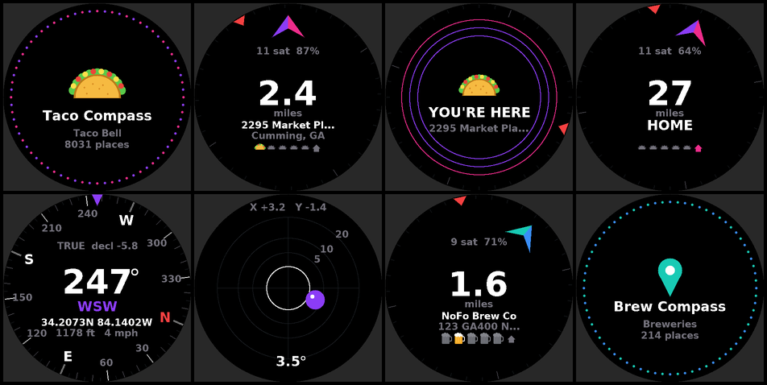
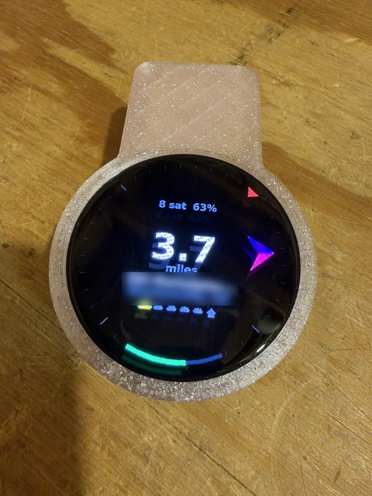
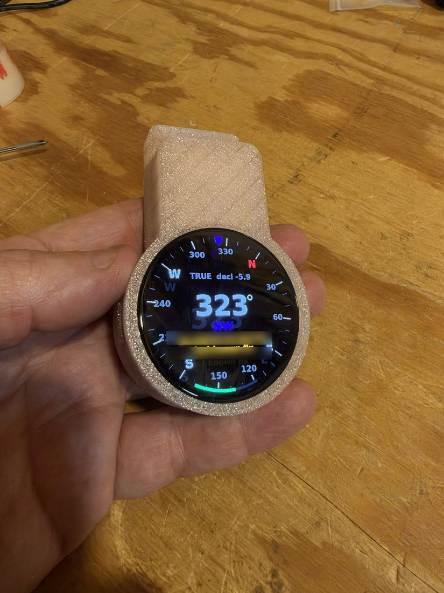
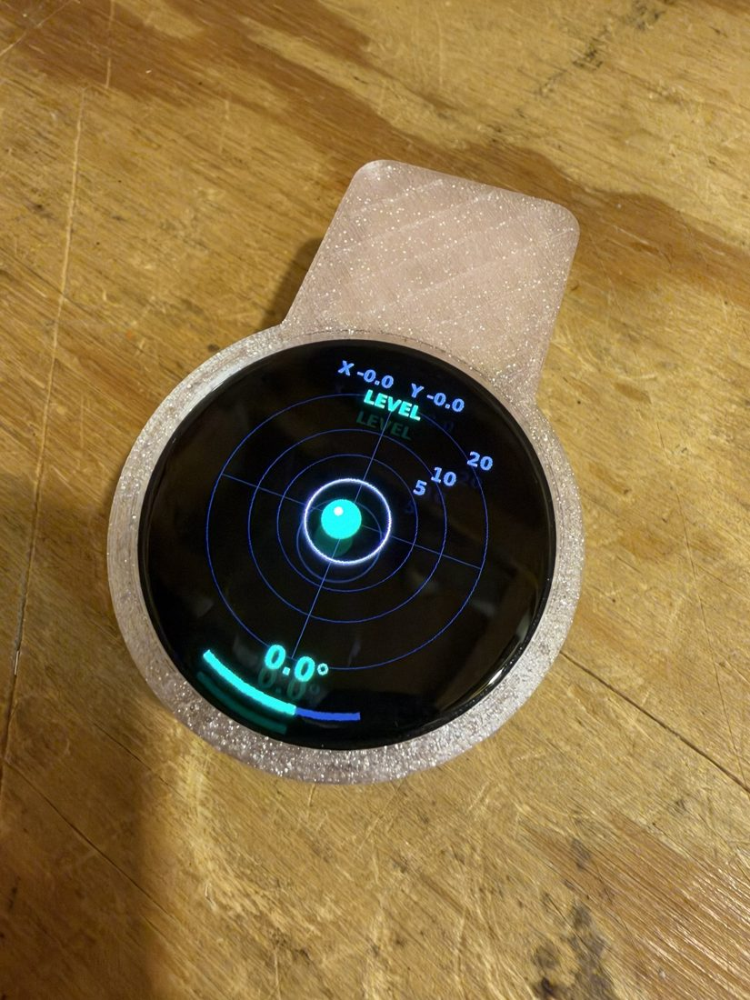
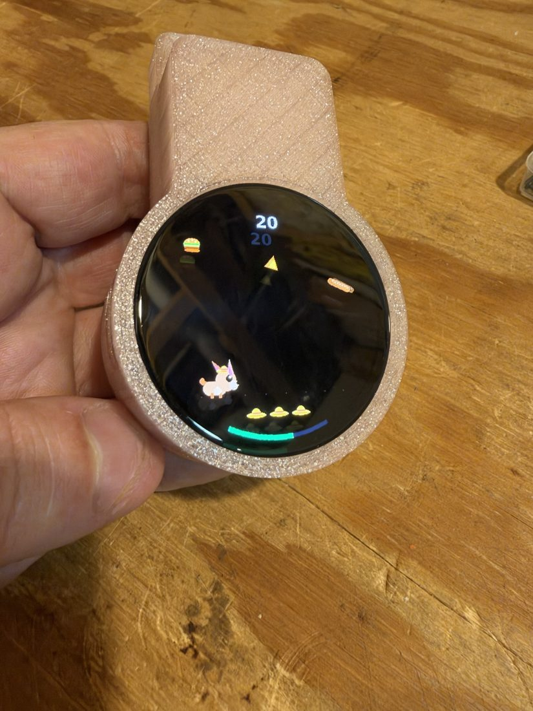
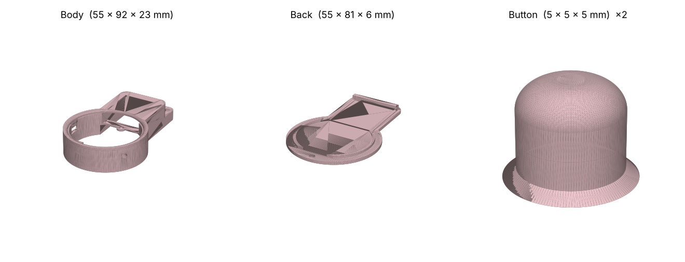
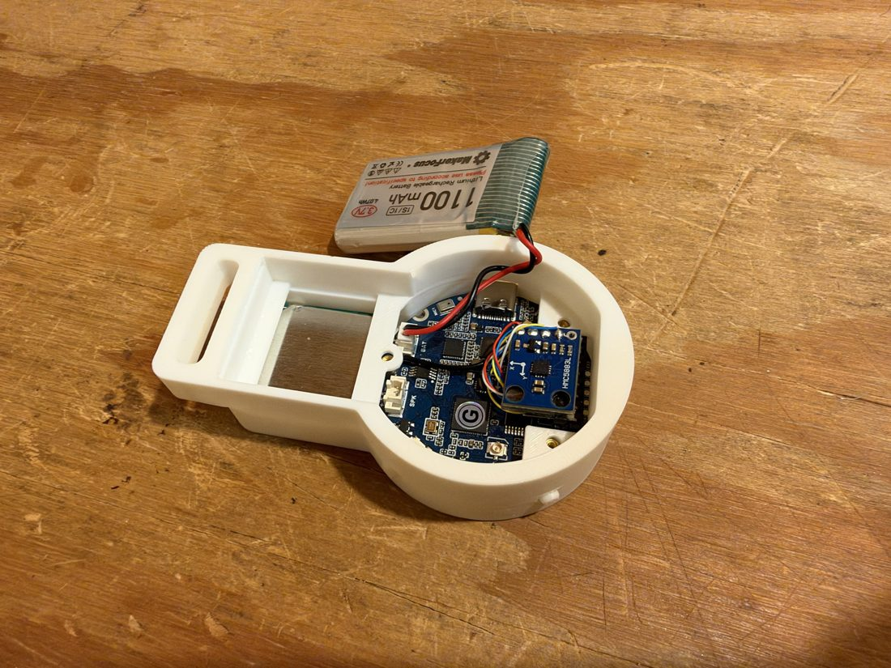
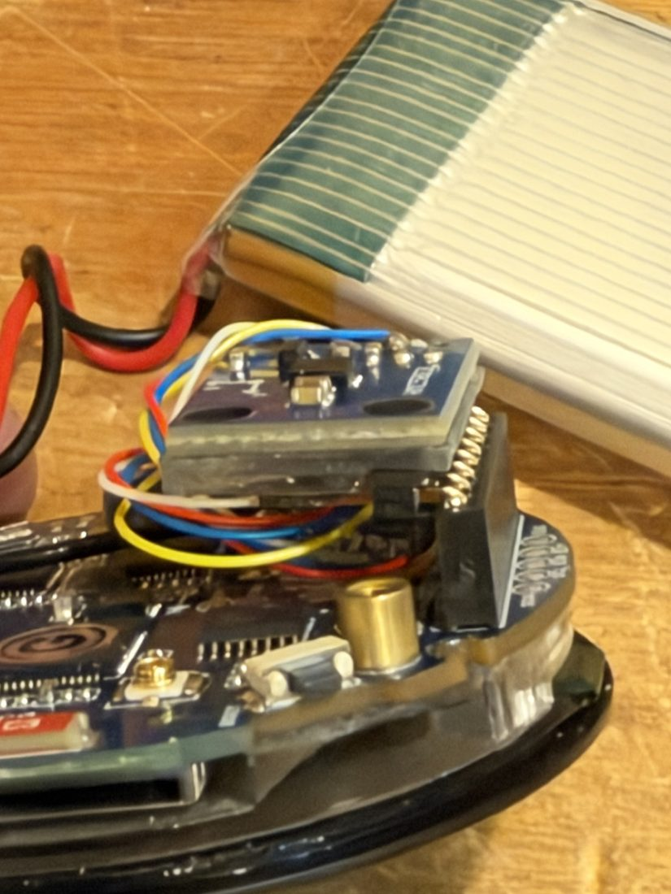

# Taco Compass

A round handheld compass that points to the nearest Taco Bell, or to anything else you give it a list of: breweries, coffee shops, trailheads, your friends' houses. Swipe left/right to step through the five nearest plus Home; swipe up/down to change pages. It also has a full compass page and a bubble level. It works completely offline. The places, a magnetic-declination model and everything else live in flash.



*Splash · finder · arrival · Home · compass · level · a brewery build with a custom icon · plain-pin theme. Every screen here is rendered from the real UI code (`make -C test preview`).*

**The original build**, in glitter PETG. Print files and the build story are on **[MakerWorld](https://makerworld.com/en/models/3660378-taco-compass)**.

<p>




</p>

*Inspired by [Tru Narla's](https://www.dexerto.com/food/woman-builds-compass-for-fiance-that-only-points-to-nearest-taco-bell-3410370/) handheld Taco Bell compass, which made the rounds in 2026. This is an independent build from scratch; no code or design was borrowed. Go look at hers, it's delightful.*

*Not affiliated with, endorsed by, or sponsored by any restaurant chain. The taco art is original, made of circles and rectangles.*

---

## Contents
1. [Features](#features)
2. [Hardware](#hardware)
3. [Wiring](#wiring)
4. [Enclosure notes](#enclosure-notes)
5. [Software setup](#software-setup)
6. [Choosing what it points to](#choosing-what-it-points-to)
7. [Building and flashing](#building-and-flashing)
8. [First-time setup](#first-time-setup)
9. [Using it](#using-it)
10. [Serial console](#serial-console)
11. [What's saved, and where](#whats-saved-and-where)
12. [Configuration (`config.h`)](#configuration-configh)
13. [Troubleshooting](#troubleshooting)
14. [How it works](#how-it-works)
15. [Development and tests](#development-and-tests)
16. [Credits and licenses](#credits-and-licenses)

---

## Features
- **Finder:** an orbiting pointer and distance to the 5 nearest places, plus Home. Swipe left or right to change target. It shows a "YOU'RE HERE" screen within 40 m.
- **Home waypoint:** set it on the device (hold PWR+BOOT) or over serial. It's stored in flash and is never in the source code.
- **Compass page:** a rotating card with true north (WMM2025 declination), a 16-point cardinal, coordinates, altitude and speed.
- **Bubble level:** a square-root ring scale that's most sensitive near level, with X/Y angles and a zero you can set.
- **Any category:** load your own list as **KML/KMZ** (e.g. exported from Google My Maps), or use the built-in Taco Bell preset from OpenStreetMap.
- **Themes:** `taco` (tacos and purple/magenta), `pin` (a map pin and teal/blue), or `icon` (any PNG you provide).
- **Units:** **Freedom Units** (ft/mi/mph) or metric. You can switch at any time; the choice is saved.
- **Heading:** a tilt-compensated magnetometer when on foot. Above ~5.6 mph it switches to GPS course automatically, because magnetometers are useless in a car.
- **Battery-friendly:** it naps on its own when still and powers itself off after a long nap. The GPS stays warm during naps.
- Works indoors from the **last known fix** while it reacquires the sky.
- **Nacho Dog:** a tilt-steered snack game starring a chihuahua in a sombrero. The high score is saved.
- **About page:** your own dedication, with inline icons and a scrolling line. It's also the power-on screen.

---

## Hardware

| Part | Notes |
|---|---|
| **Waveshare ESP32-S3-Touch-AMOLED-1.75-G** (SKU 31264) | **Get the -G (GPS) version.** It has a 466×466 round AMOLED with touch, an onboard LC76G GNSS chip with a ceramic antenna, a QMI8658 accelerometer, an AXP2101 power chip, and 16 MB flash plus 8 MB PSRAM. Sold by Waveshare and several resellers on Amazon. Docs: <https://docs.waveshare.com/ESP32-S3-Touch-AMOLED-1.75> |
| **Magnetometer breakout** | **Adafruit LIS3MDL #4479** recommended. The firmware auto-detects LIS3MDL, MMC5603 (Adafruit #5579), QMC5883L, QMC5883P and HMC5883L. Cheap "GY-271"/"GY-273" boards carry one of the last three, whatever the listing says. The original build uses a QMC5883P; HMC5883L support is untested on hardware. **Watch out for the LIS3DH/LIS3DSH**: one letter off from the LIS3MDL, but it's an accelerometer with no magnetometer. |
| **1S LiPo** with an **MX1.25 2-pin** plug | Often sold as "JST 1.25"; it's **not** JST-PH. **Check polarity against the board silkscreen before plugging in.** Pick a capacity that fits your enclosure. |
| USB-C **data** cable | Charge-only cables are the #1 cause of "board not found". |

### Parts in the original build
| Part | What was used |
|---|---|
| Board | Waveshare ESP32-S3-Touch-AMOLED-1.75-G. Specs and docs: <https://docs.waveshare.com/ESP32-S3-Touch-AMOLED-1.75> |
| Magnetometer | Comimark GY-273 module, 2-pack: <https://a.co/d/04HiKwqD>. The listing says HMC5883L, but these carried a **QMC5883P** (I²C 0x2C). Sellers swap chips freely, so check yours: the boot line (`mag=…`) and `info` show which one you got. Any of the supported chips works. |
| Battery | MakerFocus 3.7 V 1100 mAh LiPo, 1S 1C, "JST 1.25" (MX1.25) 2-pin plug, 30 × 8.5 × 51 mm (W × H × L) |
| Fasteners | Three M2 × 4 mm flat-head screws for the board, plus one for the back |

On battery life: expect roughly 6–7 hours of continuous screen-on use from 1100 mAh, or about half that from a 500 mAh pack. These are estimates, not measurements. Day to day it naps after 3 minutes still and powers off after 30 minutes of napping, so a charge lasts much longer than the continuous figure.

**Leave out the speaker that ships with the board.** Its magnet would sit a centimeter from your compass.

The board doesn't have a magnetometer, only a 6-axis accelerometer and gyro, which is why it needs the breakout.

### Onboard resources the firmware uses (fixed by the board)

| Function | Pins / address |
|---|---|
| AMOLED (CO5300, QSPI) | CS 12, SCLK 38, D0–D3 = 4/5/6/7, RST 39 |
| Onboard I²C bus | SDA 15, SCL 14: AXP2101 0x34, TCA9554 expander 0x20, QMI8658 0x6B, CST9217 touch 0x5A (INT 11, RST 40), LC76G GNSS 0x50/0x54 |
| PWR button | AXP2101 (press events) + TCA9554 EXIO4 (live level) |
| BOOT button | GPIO 0 |

---

## Wiring

The onboard I²C bus isn't broken out, so the magnetometer gets its own bus on the 8-pin header's UART0 pins. Those pins are free because the console runs over native USB.

| Header pin | Signal | Magnetometer |
|---|---|---|
| 2 | GND | GND |
| 3 | 3V3 | VIN / 3V3 |
| 4 | GPIO43 (silkscreen TXD) | **SDA** |
| 5 | GPIO44 (silkscreen RXD) | **SCL** |

The Adafruit and GY-271 boards already have I²C pull-ups. During reset the chip's boot ROM prints a few bytes on GPIO43; that's harmless to the magnetometer. If SDA and SCL end up swapped, the firmware finds the magnetometer anyway and says so on the serial console.

### GPS: bridge R15 for serial (recommended)
Out of the box the LC76G talks to the ESP32 only over I²C, and that works badly:
- **It jams.** Any reset that interrupts a transfer, including every upload, can wedge it. The module runs off the always-on 3.3 V rail, so an ESP32 reset never power-cycles it.
- **It hogs the bus.** Each poll holds the shared I²C bus for a few hundred milliseconds, so the accelerometer stalls and the level and compass stutter about once a second.

The board has unpopulated pads that connect the GPS's serial port to the ESP32. Bridging them fixes both problems.

| Pads | Connects | Needed? |
|---|---|---|
| **R15** | GPS TXD → ESP32 GPIO18 | **Yes.** This carries the position data. |
| R16 | ESP32 GPIO17 → GPS RXD | Optional. Only for sending commands to the GPS, which the firmware doesn't do yet. The original build bridges both, which leaves room for that later. |

**Where:** to the right of the Waveshare ® logo, left of RP4, just above C30. They're tiny 0402 pads.

**How:** flux, a fine tip, and a touch across the pair. A 0 Ω 0402 resistor also works. Check with a meter (power off) that the two pads beep to each other and not to GND, 3V3 or the neighbouring parts.

**Check it works** before changing settings: power up, type `gpsuart`, and you should see NMEA text (`$G...` and `$PAIR...` lines) on **RX=GPIO18 @115200**.

`GPS_USE_UART` in `config.h` is **1** by default, which needs the R15 bridge. **Without the mod, set it to 0.** I²C mode works: it resets the module at boot and after 30 s without data, and it clears stuck transfers. You'll still see the once-a-second stutter, though, and occasional recoveries in the serial log.

---

## Enclosure notes
**Printable enclosure:** the STLs are in [`enclosure/`](enclosure/) and on [MakerWorld](https://makerworld.com/en/models/3660378-taco-compass). The case is a round bezel for the display with a tower on top for the GPS antenna and a lanyard slot at the far end. The original was printed in glitter PETG.



| File | Print | Notes |
|---|---|---|
| [`Body.stl`](enclosure/Body.stl) | 1 | Bezel, antenna tower, lanyard slot, board screw studs. Use supports for the small overhangs, especially the button holes and the slot for the back's tab. |
| [`Back.stl`](enclosure/Back.stl) | 1 | Slides in with a tab at the top and closes with one screw. Clean every bit of support out of the tab. |
| [`Button.stl`](enclosure/Button.stl) | 2 | PWR and BOOT extensions, with a flange that keeps them from falling out. |

### Assembly
1. **Antenna first.** Set the GPS antenna in the tower and fix it to the inside of the case with double-sided tape or a couple of drops of hot glue.
2. **Buttons next.** Drop in the button extensions. They should glide smoothly and not stick. If the small overhangs were printed without supports, drill or file the button holes out until they do.
3. **The board.** Seat it carefully, checking the fit of the header, the USB port, and that the buttons sit flush before pressing it into place. Route the antenna cable between the screw stud and the battery connector so it isn't pinched.
4. **Screw it down** with three M2 × 4 mm flat-head screws.
5. **The compass module.** Connect it with a right-angle pin header, short end into the board's header, so it sits low. Double-sided tape the magnetometer module to the top of the header: that holds it up off the board, away from components that interfere. The photos below show location and orientation.
6. **The battery.** Give the battery wires a couple of twists, which keeps the current loop from disturbing the compass. Secure the battery with thin double-sided tape, and tuck the spare wire under it, away from the compass module.
7. **The back.** It has a mounting tab at the top. Clean every bit of support material out of the case's slot and off the tab first, then fit the tab into the slot and slide the back up to engage it. That lines up the single screw hole; screw it closed.
8. **Calibrate.** With everything in place, send `uncal`, redo the magnetometer calibration, and re-zero the level. The battery, screws and antenna all shift the magnetic field a little, and the board won't sit perfectly flat in the case.

<p>


</p>

*Inside the case: the GPS antenna (with its steel backplate) sits in the tower, and the compass module is taped on top of the right-angle header, away from the battery. The battery sits behind the antenna once it's in.*

### Design notes
- **Keep the magnetometer away from magnetic parts.** That means the battery and its wires, the USB-C connector shell, the power chip's inductor, any speaker, and steel screws. 2–3 cm makes a big difference. Calibration removes a nearby part's constant offset, but not all of the way steel bends the field around itself.
- **The stock GPS antenna has a steel backplate.** Put the battery behind it rather than the compass module. In the original build the compass module sits behind the board instead.
- **The compass module can mount in any orientation;** tell the firmware how afterwards with a `raw` spin test (see [axis mapping](#1-axis-mapping)). In the original build it's mounted face-down and flipped left-to-right, so `MAG_MAP_X_SIGN` and `MAG_MAP_Z_SIGN` are both `-1`. Lying flat and screen up, `raw` should show the magnetometer's Z reading negative in the northern hemisphere.
- **If the antenna cable is too short to reach the top,** mount the board upside down and set `DISPLAY_FLIP_180 1` (see [Touch direction](#2-touch-direction), which covers mounting the board upside down).
- **The GPS antenna needs plastic only above it.** No metallic paint, foil labels or metal-filled filament on the tower.
- **Leave access for PWR, BOOT and USB-C.** Allow room around the USB opening for a chunky cable plug. Keep the buttons only 0.5–1 mm proud of the surface so they don't get pressed in a pocket.
- **Don't cover the screen with a lens that blocks touch;** swiping is how you get around.

---

## Software setup

You need **Arduino IDE 2.x** (or `arduino-cli`) and **Python 3**. Pillow (`pip install pillow`) is only needed if you use a custom icon.

1. **ESP32 core.** In Arduino IDE → *Preferences* → *Additional boards manager URLs*, add
   `https://espressif.github.io/arduino-esp32/package_esp32_index.json`
   then install **esp32 by Espressif, 3.3.x** from Boards Manager. Waveshare tests their examples on 3.3.10.
2. **Libraries.** Copy these three folders from Waveshare's repo into your Arduino `libraries` folder (usually `Documents\Arduino\libraries`):
   `GFX_Library_for_Arduino`, `SensorLib`, `XPowersLib`.
   Repo: <https://github.com/waveshareteam/ESP32-S3-Touch-AMOLED-1.75>, folder `examples/arduino/libraries/`.
   Use these copies, not the Library Manager versions; they're the ones known to work with this board. LVGL isn't needed.
3. **Drivers:** none. The ESP32-S3's native USB shows up as a COM port on Windows 10/11, macOS and Linux.

---

## Choosing what it points to

The places live in `TacoCompass/places_db.h`, generated by `tools/build_db.py`. There's **one category per build**. The repo ships an **empty** placeholder, so run the builder once before your first build.

### Option A: Taco Bell (the default)
```
python3 tools/build_db.py                    # All the Places: Taco Bell's own store list (~8,800, full addresses)
python3 tools/build_db.py --source overpass  # OpenStreetMap instead (~7,400; about a third lack a full address)
```

### Option B: your own list, as KML or KMZ
The easiest way to make one is **Google My Maps** (<https://mymaps.google.com>):
1. Create a map and drop pins (or search and "Add to map"). Give each pin a name, and an address if it doesn't fill one in itself.
2. Use the map's ⋮ menu → **Export to KML/KMZ**, and pick the layer. A KMZ also carries the pin icon.
3. Build:
```
python3 tools/build_db.py breweries.kmz --title "Breweries" --device-name "Brew Compass"
python3 tools/build_db.py spots.kml --icon mug.png        # any PNG/JPG as the place icon
python3 tools/build_db.py big_list.kml --bbox 30,-86,35,-80   # keep only a lat/lon box
```
Google Earth, gpx.studio, Garmin BaseCamp and most mapping tools can also export KML.

**The KML elements it reads (deliberately few):**

| Element | Becomes |
|---|---|
| `Document/name` | The category title (unless `--title`) |
| `Placemark/name` | The place name (line 1 on the finder) |
| `Placemark/address` | Street (line 2) and "City, ST", split at the first comma. A ZIP code and ", USA" are dropped; full state names become abbreviations. |
| `Placemark/description` | Used for the address when there's no `<address>` (first line, HTML stripped) |
| `Placemark/Point/coordinates` | `lon,lat[,alt]`. KML lists **longitude first**. |
| KMZ contents | The first `.kml` inside (preferring `doc.kml`); the first PNG/JPG becomes the icon unless `--icon` is given |

Everything else (folders are walked through, styles, lines, polygons, extended data, timestamps) is ignored. Pins within 30 m of each other that share a name are merged. Text is reduced to plain ASCII to match the display fonts.

**Builder options:**

| Option | Default | Meaning |
|---|---|---|
| `--title` | KML document name, or "Taco Bell" | Category name, shown on the splash screen. A place whose name equals the title (every "Taco Bell") shows its street and city instead. |
| `--device-name` | "Taco Compass" | Headline on the splash screen |
| `--theme taco\|pin\|icon` | `taco` for Taco Bell; `icon` if an icon is available; else `pin` | Place marker and accent colors. You can change it later over serial. |
| `--icon file.png` | none | Custom icon. Transparent edges are trimmed, and it's pre-scaled to 96 px (splash/arrival) and 28 px (dot row). |
| `--bbox minLat,minLon,maxLat,maxLon` | none | Geographic filter |
| `--source overpass\|atp` | `atp` | Data source for the Taco Bell preset |
| `--empty` | | Write an empty placeholder |

**Flash budget:** about 12 bytes per place plus its text (roughly 40–90 bytes). The whole US Taco Bell list (~8,000) is ~350 KB, and an icon adds ~18 KB. The app partition is 3 MB, so tens of thousands of places fit.

Data notes: OpenStreetMap data is © OpenStreetMap contributors (ODbL); All the Places data is CC0. Your own KML is yours.

---

## Building and flashing

Arduino IDE board settings:

| Setting | Value |
|---|---|
| Board | **ESP32S3 Dev Module** |
| USB CDC On Boot | **Enabled** |
| Flash Size | **16MB** |
| PSRAM | **OPI PSRAM** (required for the display framebuffer) |
| Partition Scheme | **16M Flash (3MB APP/9.9MB FATFS)** |
| Erase All Flash Before Sketch Upload | **Disabled** (otherwise Home and calibrations are wiped) |

Open `TacoCompass/TacoCompass.ino`, pick the COM port and Upload.

arduino-cli equivalent:
```
arduino-cli compile --upload -p COM5 \
  --fqbn esp32:esp32:esp32s3:CDCOnBoot=cdc,FlashSize=16M,PSRAM=opi,PartitionScheme=app3M_fat9M_16MB \
  TacoCompass
```
If an upload can't connect, **hold BOOT while plugging in USB** to force download mode, then upload again.

---

## First-time setup

Open the Serial Monitor at **115200** (line ending: *Newline* or *Both*). Type `?` for the command list. On first boot with no calibration the device starts magnetometer calibration on its own; press BOOT to cancel it until the axes are mapped.

### 1. Axis mapping
Type `raw` to stream sensor values. Lay the device flat, screen up.

**Accelerometer.** `acc` should read about `0 0 +1`.
- Raise the 12-o'clock edge: acc **Y goes positive**.
- Raise the 3-o'clock edge: acc **X goes positive**.

**Magnetometer.** Spin it slowly through a full turn, flat.
- mag **Y** should peak when 12 o'clock faces north.
- mag **X** should peak when 3 o'clock faces north.
- mag **Z** should read strongly negative with the screen up (anywhere in the northern hemisphere).

Fix any axis or sign that's off with `ACC_MAP_*` / `MAG_MAP_*` in `config.h` and re-upload.

### 2. Touch direction
On the Finder page, swiping **left** should go to the **next** target, and swiping **up** should go to the **next page** (Finder → Compass → Level).
- Left/right backwards: set `TOUCH_INVERT_X 1`.
- Up/down backwards: set `TOUCH_INVERT_Y 1`.
- Left/right changes pages and up/down changes targets (the axes are swapped): set `TOUCH_SWAP_XY 1`.

**Mounting the board upside down** (say, so a short GPS antenna cable reaches the top of the case): set `DISPLAY_FLIP_180 1` in `config.h`. That one switch turns the picture, the touch, the accelerometer and the magnetometer 180° together. Don't touch the `ACC_MAP_*`, `MAG_MAP_*` or `TOUCH_*` lines for this. Afterwards, send `uncal` and redo the magnetometer calibration, and re-zero the level, because both were stored for the old orientation.

### 3. Magnetometer calibration
Hold **BOOT 2.5 s** on the Finder or Compass page, or type `cal`. Tumble the device through big figure-8s in every orientation for 20 s. The outer purple ring is time; the inner green ring is how much of the sphere you've covered. Redo it after any change to the enclosure or battery.

### 4. Level zero
Put the finished device on a known-flat surface, go to the Level page and **hold BOOT 2.5 s**.

### 5. Home
Stand at home with a GPS fix and **hold PWR + BOOT together for 1.5 s**, or type `home 34.2073,-84.1402`.

---

## Using it

Five pages. **Swipe up/down** to move between them (or press **BOOT**). Dots at the right edge flash briefly to show where you are.

1. **Finder.** Points to the 5 nearest places, then 🏠 Home. The row of icons under the address shows which one is selected.
2. **Compass.** A rotating card. The top line says **TRUE** (with the declination) when there's a fix, **MAGNETIC** without one, or **GPS COURSE** when moving fast.
3. **Level.** The bubble floats to the high side. It turns green and shows **LEVEL** inside 0.5°.
4. **Nacho Dog.** A game; see [Nacho Dog](#nacho-dog) below.
5. **About.** The title, up to three lines of your own, a scrolling message, and how many places are loaded. It also shows for a few seconds at power-on. See [Personalizing the About page](#personalizing-the-about-page).

| Control | Does |
|---|---|
| **Swipe left / right** | Finder page: next / previous target |
| **Swipe up / down** | Next / previous page (wraps around) |
| **Tap** | Nacho Dog page: start a game |
| **BOOT** short | Next page (the backup when touch can't help: gloves, wet glass). *Mid-game:* end the game. |
| **BOOT** hold 2.5 s | Calibrate the magnetometer. *On the Level page:* zero the level. |
| **PWR** short | Nap / wake |
| **PWR + BOOT** together 1.5 s | **Set Home = where you're standing** (any page; needs a live fix) |
| **PWR** hold 6 s | Hard power off (AXP2101). Press PWR to turn it back on. |

Behaviour worth knowing:
- **Home** until set shows *"Home not set: hold PWR + BOOT while you're home."* Arriving shows **WELCOME HOME**. If no places are loaded, Home is the only target.
- **Labels:** places with their own names (breweries) show **name + street**. Places that are all one chain (Taco Bell) show **street + city**.
- **Nap** turns off the display and light-sleeps the CPU, but the GPS keeps tracking. It naps after 3 min without motion on battery (10 min on the Level page) and powers off after 30 min of napping. On USB power it never auto-naps.
- **Last known fix:** the position is saved every minute (once you've moved more than 100 m), so indoors it points from there right away. Amber text means it's using that saved fix.
- **Driving:** above ~5.6 mph the heading comes from GPS course instead of the magnetometer.
- **Distances** are straight-line, not driving distance. "Nearest" is as the crow flies.

### Nacho Dog
**Tap** to start. The tilt you're holding at that moment becomes level, so play it flat on a table or held up in front of you. Tilt the top edge up (or toward you, when held upright) to climb, and the other way to dive.

| Snack | Points |
|---|---|
| Tortilla chip | +5 |
| Taco | +10 |
| Churro | +20 |
| Burger | costs a sombrero |

- **Lives:** three sombreros sit along the bottom. A burger X's one out, and losing the third ends the game. Missing food costs nothing.
- **Difficulty:** every 50 points the food rolls in faster and more often, and burgers get a little more common.
- **Controls during a game:** swipes are ignored, so a stray thumb can't change pages. **BOOT** ends the game, and **PWR** naps (pausing it). The device never auto-naps mid-game.
- **Best score** is saved in flash.
- **Tuning:** speed, spawn rate and odds are at the top of `NachoGame::spawn()` and `update()` in `game.cpp`. Tilt sensitivity is `FULL_TILT_DEG` in `game.h` (20°: tilt that far for the full height).

### Personalizing the About page
Copy `TacoCompass/about.example.h` to `TacoCompass/about.h` and edit it:

```c
#define ABOUT_TITLE  "Taco Compass"     // "" = the device name from the database
#define ABOUT_LINE1  "For Someone"      // the first line is larger and in the accent color
#define ABOUT_LINE2  "Love, Me"
#define ABOUT_LINE3  "{tree} 2026"
#define ABOUT_SCROLL "So you can always find a Taco Bell, and find your way home {heart}"
```

- **Inline icons:** `{heart}`, `{tree}`, `{taco}` and `{star}`. The fonts are plain ASCII, so these are drawn as small pictures.
- **Empty lines** are skipped, and an empty `ABOUT_SCROLL` turns off the scrolling line. Keep each line short: about 18 characters for line 1 and 26 for the others.
- **Power-on time:** `ABOUT_BOOT_MS` in `config.h`, 3500 ms by default; 0 skips it.
- **Privacy:** `about.h` is in `.gitignore`, so a personal dedication stays out of the repo. Without it, the page shows just the device name and the place count.

---

## Serial console

115200 baud; type `?` for this list.

| Command | Does |
|---|---|
| `?` / `help` | List commands |
| `info` | Device, database, units, theme, sensors, GPS, heading, Home, the 5 nearest with bearings |
| `home` | Show Home |
| `home 34.2073,-84.1402` | Set Home to coordinates (comma and/or space between them) |
| `home here` | Set Home to the current live fix |
| `home clear` | Forget Home |
| `units` | Show units |
| `units freedom` / `units metric` | ft/mi/mph or m/km/km/h |
| `theme` | Show theme |
| `theme taco` / `pin` / `icon` / `default` | Place marker and colors (`icon` needs a database built with one; `default` = the database's choice) |
| `raw` | Toggle streaming accel/mag/heading (for axis mapping) |
| `cal` / `uncal` | Calibrate / forget the magnetometer calibration |
| `unlevel` | Forget the level zero |
| `fix 34.2073,-84.1402` / `fix off` | Fake a position for desk testing (not saved) |

---

## What's saved, and where

Everything persistent is in the ESP32's **NVS flash** (namespace `taco`). It survives power-off, a dead battery and re-flashing. It's only wiped if *Erase All Flash Before Sketch Upload* is enabled.

| Setting | Keys | Written when |
|---|---|---|
| Home | `hlat` `hlon` `hset` | You set or clear it |
| Magnetometer calibration | `cal` | Calibration finishes / `uncal` |
| Level zero | `lr0` `lp0` | You zero it / `unlevel` |
| Units | `units` | `units freedom\|metric` |
| Theme | `theme` | `theme ...` |
| Last known fix | `lat` `lon` `fix` | At most once a minute, only after moving more than 100 m |

The current page and the selected target are kept in RAM only, so it always starts on the Finder.

---

## Configuration (`config.h`)

| Setting | Default | What it does |
|---|---|---|
| `MAG_MAP_*`, `ACC_MAP_*` | identity | Sensor axis mapping (see first-time setup) |
| `DISPLAY_FLIP_180` | 0 | Board mounted upside down: rotates the screen, touch and both sensors 180° together |
| `TOUCH_SWAP_XY`, `TOUCH_INVERT_X`, `TOUCH_INVERT_Y`, `SWIPE_MIN_PX` | 0, 1, 1, 70 | Touch orientation and swipe sensitivity |
| `GPS_USE_UART`, `GPS_UART_RX`, `GPS_UART_TX`, `GPS_UART_BAUD` | 1, 18, 17, 115200 | GPS over serial (needs the [R15 bridge](#gps-bridge-r15-for-serial-recommended)); 0 = I²C |
| `PIN_MAG_SDA`, `PIN_MAG_SCL`, `MAG_I2C_HZ` | 43, 44, 400 kHz | Magnetometer bus |
| `I2C0_HZ` | 100 kHz | Onboard bus; try 400000 for faster GPS reads once everything works |
| `NUM_NEAREST` | 5 | Targets in the finder cycle (max 16) |
| `ARRIVED_METERS` | 40 | "YOU'RE HERE" radius |
| `GPS_HEADING_MIN_MPS`, `GPS_HEADING_HYST_MPS` | 2.5, 0.8 | Switch to GPS course above this speed |
| `HEADING_SMOOTH_ALPHA` | 0.18 | Needle smoothing (higher = snappier) |
| `BRIGHTNESS` | 200 | AMOLED brightness, 0–255 |
| `CAL_SECONDS` | 20 | Calibration duration |
| `LONG_PRESS_MS`, `HOME_SET_HOLD_MS` | 2500, 1500 | Button hold times |
| `NAP_AFTER_STILL_S`, `POWEROFF_AFTER_NAP_S` | 180, 1800 | Auto-nap and auto-off (0 = never) |
| `SAVE_FIX_EVERY_S` | 60 | Last-fix save interval |
| `DEFAULT_METRIC` | 0 | Units on a fresh device (0 = Freedom Units) |

---

## Troubleshooting

Start with `info` on the serial console; it reports every subsystem.

| Symptom | Check |
|---|---|
| Blank screen, serial says *display init failed* | **PSRAM: OPI PSRAM** in board settings |
| `gpsBytes` stays 0 in `info` | **Serial mode (`GPS_USE_UART 1`) without the R15 bridge:** bridge it, or set `GPS_USE_UART 0`. **In I²C mode:** watch the `[gps]` lines on the serial console. The module should answer about 400–700 ms after each reset. If it never does, power it fully off (unplug USB *and* the battery) for a minute. |
| `gpsBytes` climbs but no fix | Antenna placement (it needs sky); first fix outdoors can take a minute or two |
| `mag=none` | Wiring to header pins 2–5, 3V3 vs GND, SDA/SCL swapped |
| Heading off by a constant amount | Axis mapping, then recalibrate |
| Heading wanders as you tilt | `ACC_MAP_*` (tilt compensation needs the accelerometer axes right) |
| Swipes backwards or ignored | `TOUCH_INVERT_X` / `TOUCH_INVERT_Y` / `TOUCH_SWAP_XY`; `info` shows `touch=1` if the controller was found |
| Image shifted a few pixels | The CO5300 column offset (6, from Waveshare) in `ui.cpp` |
| "No places loaded" | Run `tools/build_db.py`, then rebuild |
| Upload can't connect | Data cable; hold BOOT while plugging in |

---

## How it works
- **Two cores.** Core 0 runs one task that owns the onboard I²C bus: GPS, accelerometer, touch, power chip and button levels. GPS reads are non-blocking, and the long ones wait until no finger is on the glass so swipes are never cut short. Core 1 runs the UI, the magnetometer (on its own bus) and the logic.
- **GPS:** the LC76G's NMEA arrives over serial (with the R15 bridge) or over I²C using Quectel's length-query protocol. In I²C mode the firmware does several things:
  - pulses the module's RESET line (TCA9554 P7) at every boot and after 30 s without data,
  - waits 100 ms between protocol steps,
  - holds the bus for each whole transaction,
  - clears interrupted transfers by reading a byte from 0x54 and 0x58.
  
  It never writes config to the module: those writes were found to re-jam it. A small parser handles RMC and GGA from any talker (GP/GN/GL/...).
- **Heading:** a min/max hard- and soft-iron calibration, then tilt compensation from the accelerometer (East = Down × B, North = East × Down), then WMM2025 declination from a 2° global grid in flash, then circular smoothing. Above walking speed it uses GPS course over ground instead.
- **Nearest search:** a brute-force pass over every place using a cheap equirectangular metric, then exact haversine distance and bearing for the winners. It handles the antimeridian, and 8,000 places take a few milliseconds.
- **Display:** a full-frame canvas in PSRAM pushed over QSPI, at about 15 fps with no flicker. Fonts are DejaVu Sans Bold, pre-rasterized to Adafruit-GFX format.
- **Power:** the AXP2101 handles the PWR key and hard-off. Naps use ESP32 light sleep, woken by a timer to poll the PWR key, or by BOOT.

---

## Development and tests

Everything hardware-independent is tested on a PC (needs `g++`, `make`, Python 3 and Pillow):

```
make -C test            # C++ unit tests + build_db.py tests
make -C test typecheck  # type-check all firmware files against Arduino-ESP32 signatures + Waveshare's libs
make -C test preview    # render every screen to test/preview/*.png using the real ui.cpp
```

They cover:
- distance, bearing and nearest-N against brute force, including across the antimeridian
- declination against WMM2025 reference values
- NMEA parsing (checksums, hemispheres, split chunks, garbage, altitude)
- tilt-compensated heading across tilts, headings and latitudes
- calibration recovery
- buttons, four-direction swipes (taps, diagonals, slow drags and sample gaps are ignored), level angles and cardinals
- distance formatting in both unit systems
- coordinate and label parsing
- the KML/KMZ builder, including compiling its output

**Status:** the firmware was developed against Waveshare's pin map and example code, and checked as above, but **not yet run on hardware**. Expect a short first-flash shakedown: GPS I²C timing, axis maps and touch direction. The [troubleshooting](#troubleshooting) table covers each one.

Regenerating the bundled data (rarely needed):
```
python3 tools/build_decl.py     # declination grid (pip install pygeomag); WMM2025 is valid through 2029
python3 tools/make_fonts.py     # fonts (Pillow + a TTF)
```

### Layout
```
TacoCompass/           Arduino sketch
  TacoCompass.ino      pages, modes, controls, Home, heading fusion, serial console
  config.h             pins, axis maps, timings, defaults
  board.*              core-0 task: AXP2101, TCA9554, QMI8658, CST9217 touch, LC76G GPS
  mag.*                LIS3MDL / MMC5603 / QMC5883L / QMC5883P / HMC5883L on Wire1
  ui.*                 all drawing: themes, icons, pages
  game.*               Nacho Dog game logic (no hardware; host-tested)
  geo.* nmea.* heading.* buttons.*   pure logic (unit-tested)
  places_db.h          generated: your places (empty placeholder in the repo)
  decl_grid.h font*.h  generated: declination grid, fonts
tools/                 build_db.py (places), build_decl.py, make_fonts.py
test/                  unit tests, build_db tests, type-check stubs, screen renderer, fixtures
docs/                  README images
```

---

## Credits and licenses
- **Board support:** pin map and driver usage follow Waveshare's ESP32-S3-Touch-AMOLED-1.75 examples. Arduino_GFX, SensorLib and XPowersLib keep their own licenses.
- **Magnetic model:** World Magnetic Model 2025 (NOAA/NCEI and BGS, public domain), computed with pygeomag.
- **Fonts:** DejaVu Sans Bold (Bitstream Vera / DejaVu license).
- **Place data:** OpenStreetMap (© OpenStreetMap contributors, ODbL) or All the Places (CC0), or your own KML.
- **Project license:** [MIT](LICENSE). That covers the code in this repo. Data you build into `places_db.h` keeps its own license; OSM-derived builds should keep the "© OpenStreetMap contributors" attribution if you redistribute them.
- **Inspiration:** Tru Narla's Taco Bell compass (see the top of this page).
- Taco Bell is a trademark of its owner. This project isn't affiliated with or endorsed by it. Use a different category and the `pin` or `icon` theme if you'd rather not have tacos at all.
